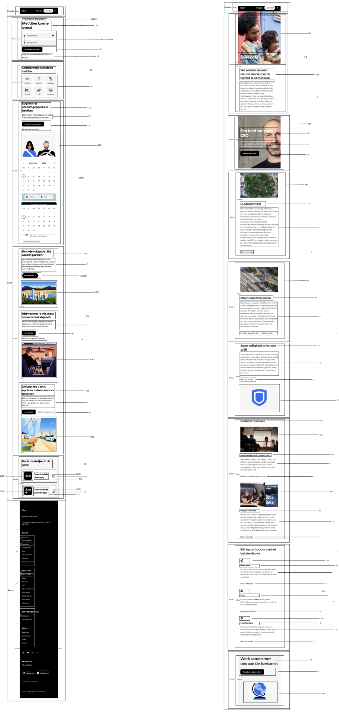
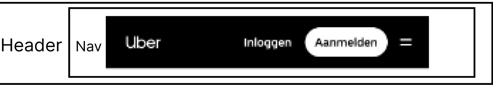
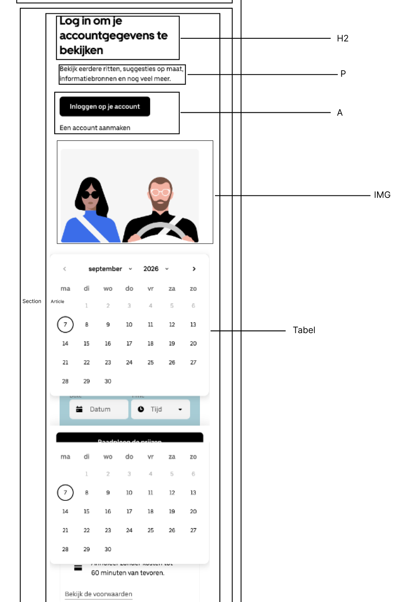
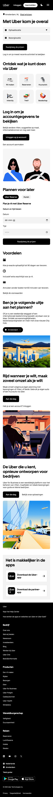
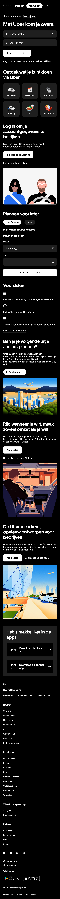
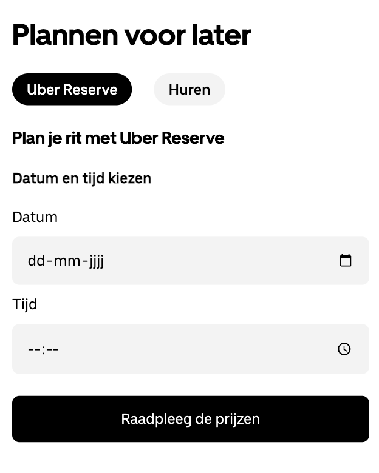

# Procesverslag
Markdown is een simpele manier om HTML te schrijven.  
Markdown cheat cheet: [Hulp bij het schrijven van Markdown](https://github.com/adam-p/markdown-here/wiki/Markdown-Cheatsheet).

Nb. De standaardstructuur en de spartaanse opmaak van de README.md zijn helemaal prima. Het gaat om de inhoud van je procesverslag. Besteedt de tijd voor pracht en praal aan je website.

Nb. Door *open* toe te voegen aan een *details* element kun je deze standaard open zetten. Fijn om dat steeds voor de relevante stuk(ken) te doen.

## Jij

  
uitwerken voor kick-off werkgroep

  ### Auteur:
  Mehmet Yasa

  #### Je startniveau:
  Blauw/Rode piste

  #### Je focus:
  Surface Plane
 

## Je website

  
uitwerken voor kick-off werkgroep

  ### Je opdracht:
  https://www.uber.com/nl/nl/ 

  https://www.uber.com/nl/nl/about
  
  #### Screenshot(s) van de eerste pagina (small screen): 

  Homepage Uber 

  

  #### Screenshot(s) van de tweede pagina (small screen):

  Overons pagina Uber  
  
  

## Toegankelijkheidstest 1/2 (week 1)

  
uitwerken na test in 2e werkgroep

  ### Bevindingen
  Lijst met je bevindingen die in de test naar voren kwamen:

  **Ging goed:**
  - Elke pagina heeft een unieke titel
  - De focusvolgorde met het toetsenbord klopt met de layout
  - Koppen worden in een logische volgorde gebruikt, zonder niveaus over te slaan
  - Animaties zijn rustig en houden rekening met prefers-reduced-motion
  - Het kleurcontrast is goed

  **Ging fout:**
  - Knoppen, links en labels zijn niet altijd uniek en beschrijvend
  - De HTML is niet valide
  - Er staat meer dan een h1 op de pagina
  - Er is geen zichtbare focus-stijl bij het tabben

  ### Wat ik hiervan meeneem

  Wat mij opviel, is dat een grote website als Uber toch veel fouten heeft op het gebied van toegankelijkheid.

  Dit ga ik in mijn eigen site beter doen:

  - Maar een h1 per pagina.
  - Een zichtbare focus-stijl, zodat je met het toetsenbord altijd ziet waar je bent.

## Breakdownschets (week 1)

  
uitwerken na afloop 3e werkgroep

  ### de hele pagina: 
  

  ### dynamisch deel (bijv menu): 
  

  ### wellicht nog een dynamisch deel (bijv filter): 
  

## Voortgang 1 (week 2)

  
uitwerken voor 1e voortgang

  ### Stand van zaken
  Ik had mijn breakdownschets gemaakt, maar die was nog niet compleet. Ook had ik al een beginnetje gemaakt aan mijn HTML.

  ### Agenda voor meeting
  samen met je groepje opstellen

  - Mijn breakdownschets laten zien
  - Mijn eerste HTML laten zien

  ### Verslag van meeting
  hier na afloop snel de uitkomsten van de meeting vastleggen

  - Mijn breakdownschets moest uitgebreider, zodat het voor mij makkelijker wordt om de HTML te schrijven.

## Voortgang 2 (week 3)

  
uitwerken voor 2e voortgang

  ### Stand van zaken
  Mijn HTML van beide pagina's was helemaal af.

  ### Agenda voor meeting
  samen met je groepje opstellen

  - Mijn HTML laten zien

  ### Verslag van meeting
  hier na afloop snel de uitkomsten van de meeting vastleggen

  - Ik moest meer articles gebruiken, in plaats van sections met articles erin.
  - Ik moest vaker ul en li gebruiken, omdat ik bij sommige elementen de verkeerde keuze had gemaakt.
  
  - Deze feedback heb ik daarna toegepast: Mijn pagina's bestaan nu uit articles, en ik gebruik ul en li voor lijstjes. 

## Toegankelijkheidstest 2/2 (week 4)

  
uitwerken na test in 9e werkgroep

  ### Bevindingen
  Lijst met je bevindingen die in de test naar voren kwamen (geef ook aan wat er verbeterd is):

  **Verbeterd ten opzichte van Uber:**
  - Elke pagina heeft maar een h1.
  - Het html-element heeft lang="nl".
  - Er is een zichtbare focus-stijl als je met Tab door de pagina gaat.
  
  **Nog niet goed:**
  - Niet alle decoratieve afbeeldingen hebben een lege alt.
  - Mijn animaties gaan nog niet uit bij prefers-reduced-motion.

## Voortgang 3 (week 4)

  
uitwerken voor 3e voortgang

  ### Stand van zaken
  De homepage was af, inclusief de footer. Ik was bezig met het stylen van de Over ons-pagina.

  ### Agenda voor meeting
  samen met je groepje opstellen
  
  - Geen meeting. Dit was een online inloopmoment waar je kon inbellen als je vragen had. Ik heb dit moment niet gebruikt, omdat ik de tijd nodig had om aan mijn website te werken.

  ### Verslag van meeting
  hier na afloop snel de uitkomsten van de meeting vastleggen

  - Geen verslag, omdat ik het inloopmoment niet heb gebruikt. 

## Eindgesprek (week 5)

  
uitwerken voor eindgesprek

  ### Je uitkomst - karakteristiek screenshots:
  
  

  ### Dit ging goed/Heb ik geleerd: 
  Korte omschrijving met plaatjes
  - Elementen selecteren met CSS-selectors zoals nth-of-type, in plaats van classes.
  - Met flexbox dingen naast of onder elkaar zetten.
  - Een thema-knop met querySelector, addEventListener en classList. Het maantje wordt een zonnetje.
  - Surfacec plane: states van controls, animaties, SVG stylen, :has() en lettergrootte.

  

  ### Dit was lastig/Is niet gelukt:
  Korte omschrijving met plaatjes
  - Uber had het blok Plannen voor later van de site gehaald, dus ik heb het zelf vormgegeven in de huisstijl.
  - Sommige knoppen doen nog niks als je erop klikt, zoals Uber Reserve, Huren en Amsterdam.

  

## Bronnenlijst

  
continu bijhouden terwijl je werkt

**Uber**
  1. Teksten, foto's en illustraties. 
  2. SVG iconen (menu, locatie, social media en wereldbol) gekopieerd via inspecteren op uber.com
  3. Fonts Uber Move en Uber Move Text, gedownload via Inspecteren > Network op uber.com

**Websites die ik heb gebruikt**
  4. MDN, :has(): https://developer.mozilla.org/en-US/docs/Web/CSS/:has
  5. MDN, :focus-visible: https://developer.mozilla.org/en-US/docs/Web/CSS/:focus-visible
  6. MDN, @font-face: https://developer.mozilla.org/en-US/docs/Web/CSS/@font-face
  7. MDN, classList: https://developer.mozilla.org/en-US/docs/Web/API/Element/classList
  8. MDN, addEventListener: https://developer.mozilla.org/en-US/docs/Web/API/EventTarget/addEventListener
  9. W3Schools, Flexbox: https://www.w3schools.com/css/css3_flexbox.asp
  10. W3Schools, :nth-of-type: https://www.w3schools.com/cssref/sel_nth-of-type.php

**AI**
  11. Claude (AI): uitleg en hulp bij het inladen van de fonts met @font-face
  12. Claude (AI): uitleg en hulp bij de CSS van de header, formulieren, kaartjes, de knoppen bij "Plannen voor later" en de footer
  13. Claude (AI): uitleg en hulp bij de Over ons-pagina (foto's met tekst erop en overons.css)
  14. Claude (AI): uitleg en hulp bij het donker thema en de JavaScript van de thema-knop en "Tekst groter"
  15. Claude (AI): uitleg en hulp bij de surface plane (:focus-visible, hover, transition, :has())
  16. Claude (AI): advies over toegankelijkheid (alt-teksten, aria-label en focus-stijl)
  17. Claude (AI): de SVG-code voor de maan en de zon (thema knop), de pijl (app kaartjes bij Het is makkelijker in de apps) en het pijltje naar beneden (Amsterdam knop) en het kruisje (menu knop)

  **Codepen / les**
  18. FED Oefening JS 3-stap 2 - Hamburger menu: https://codepen.io/shooft/pen/qEOpvZK
  19. Claude (AI): uitleg en hulp bij het inpassen van het hamburgermenu in mijn site

